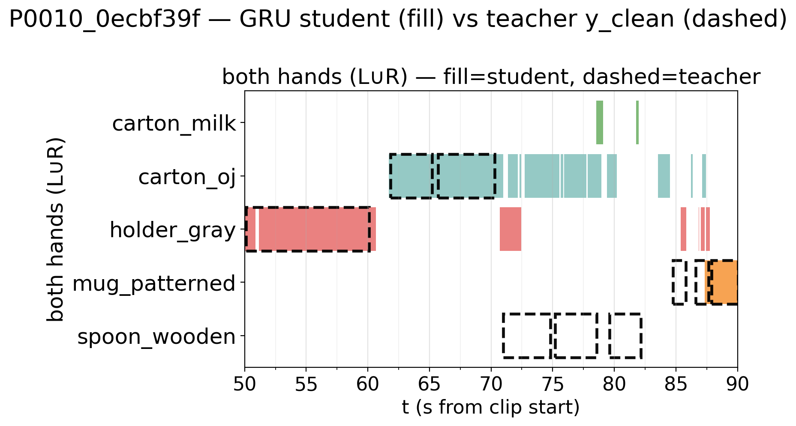

# EgoUse

Hand–object **interaction timelines** from egocentric video: *when is the wearer using each object?*

[](docs/assets/demo.mp4)

[Watch the 40 s demo](docs/assets/demo.mp4) · student fill vs teacher dashed (merged L∪R)

---

## Problem

Head-camera video (Meta Project Aria / [HOT3D](https://github.com/facebookresearch/hot3d)) is messy: hands occlude objects, the scene moves with the wearer, and “using” an object is a **time interval**, not a single box. EgoUse outputs a per-object **swimlane** (ON/OFF over time).

## Approach

**Teacher (training labels only).** Privileged HOT3D **3D poses** plus a frozen rule-based dual-dwell scorer (`teacher_aabb_stationary_v22`) produce `y*_clean`. On the one human-annotated clip (`P0003_c701bd11`): **93% precision / 95% frame accuracy** vs those annotations (merged pair-level).

**Student (deploy).** RGB only — **100DOH** hands + **YOLOE** objects, **14-D** pairwise features, causal **GRU** (`phase_d_r7`). No ground-truth boxes or poses at inference. Boxes are **raw detections** (no Kalman). On 10 held-out clips vs teacher: **76% frame accuracy**. GRU inference is **&lt;1 s** for a ~2 min clip on CPU once features exist; end-to-end from MP4 is ~**1.5 min / 40 s** on an RTX 4060 (100DOH ~78% of that). Not real-time.

Public scores and plots **merge left and right hands** (ON if either hand is ON). The student is trained per-hand.

| | Precision | Accuracy | F1 | Recall |
|--|-----------|----------|----|--------|
| Teacher vs human (1 clip) | 0.93 | 0.95 | 0.86 | 0.80 |
| Student vs teacher (prove, n=10) | 0.21 | **0.76** | 0.21 | 0.22 |
| Student vs teacher (train, n=122) | 0.65 | 0.91 | 0.77 | 0.94 |

Accuracy is high because most object–frame pairs are OFF. Event (segment) F1 on prove is ~0.05 — the student is a coarse timeline, not SOTA HOI.


## Layout

```
lib/scoring/     dual-dwell teacher + cleanup
lib/student_gru_*  GRU model, infer, train
src/run_*_pipeline.py   teacher / student / image_2d CLIs
checkpoints/phase_d_r7/best.pt
```

`image_2d` is the same dual-dwell rules on **detector** boxes (fair 2D baseline).

## Setup

```bash
python3 -m venv venv && source venv/bin/activate
pip install -r requirements.txt
bash onboarding/run_verify.sh
```

That check does not need HOT3D or detector weights. Full runs need a local HOT3D clone, 100DOH / YOLOE envs, and data — see comments in `lib/paths.py` and `scripts/download_hot3d_seqs.py`.

```bash
python src/run_teacher_pipeline.py --sequence P0003_c701bd11
python src/run_student_pipeline.py --sequence P0003_c701bd11 --skip-detect
python src/run_student_pipeline.py --video-path clip.mp4 --objects mug_white,keyboard
```
