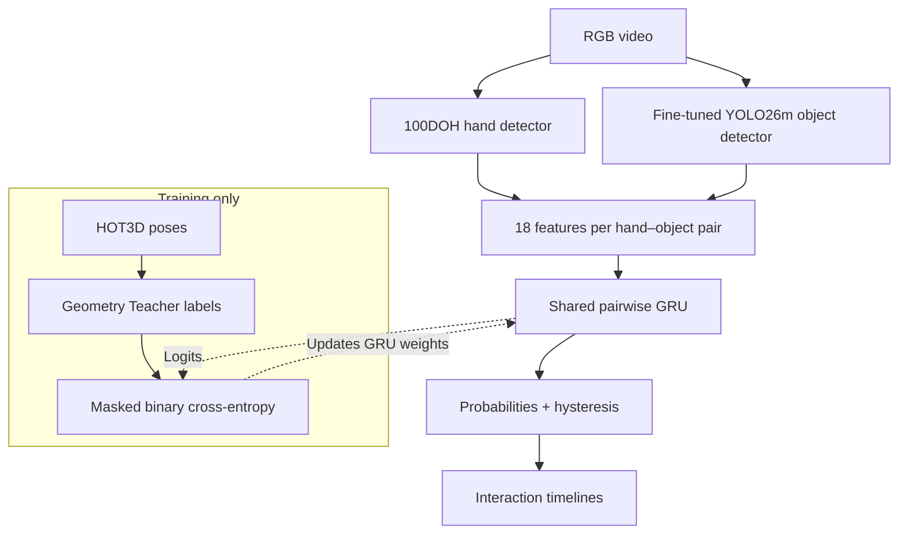
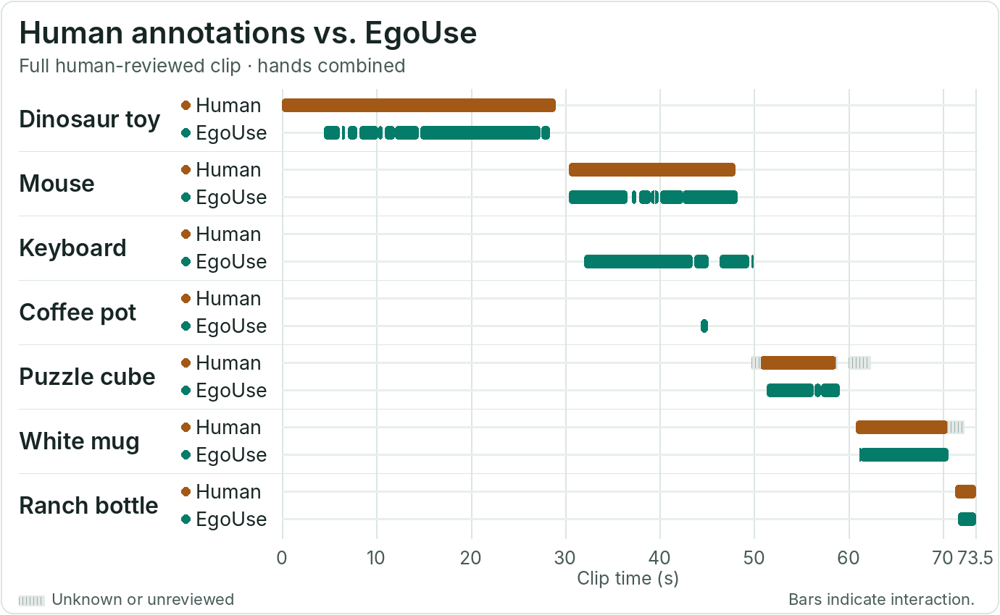
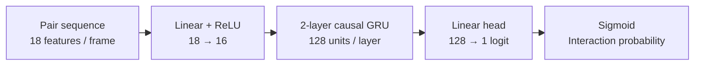

# EgoUse

**Hand–object interaction timelines from egocentric video: what is the wearer interacting with, and when?**

EgoUse explores a lightweight approach to interaction recognition for future glasses and edge devices. Instead of applying another large visual network to video, it learns from **compact hand–object features using a small GRU**.

## Approach

**Automatically generated training labels; RGB-only inference.**

[HOT3D](https://github.com/facebookresearch/hot3d) provides 3D hand and object poses. A geometry-based **Teacher** uses these to generate interaction labels, avoiding manual annotation of every training frame.

The **Student** learns from those labels using only RGB-derived detections: hand and object boxes become features describing overlap, distance, motion and detector evidence. A shared GRU tracks each pair over time and predicts interaction intervals.

- **100DOH hand detector** locates hands and estimates handedness and contact state.
- **Fine-tuned YOLO26m object detector** locates objects and classifies them into 33 HOT3D object identities.

The target is **holding, manipulation and strong physical contact**, excluding brief brushing.

The Teacher supervises training through the loss. It is not part of the inference path.

## Results

*Human annotations and EgoUse predictions across a complete clip, with hands combined. Shading marks unknown or unreviewed intervals.*

| Reference · hands combined | Frame precision | Frame recall | Frame F1 | Event F1 |
|---|---:|---:|---:|---:|
| **Human annotations · 4 clips** | **77.8%** | **68.7%** | **73.0%** | **27.9%** |
| Automatic Teacher · 10 development clips | 77.8% | 78.6% | 78.2% | 41.9% |

**Frame scores** measure interaction decisions at each moment. **Event scores** require the correct object and an interaction interval with temporal intersection-over-union of at least 0.50.

The Student trained on **119 clips** with automatic labels. **Ten development clips** selected checkpoints and supported decoder comparisons; **four human-reviewed clips** provide a manual reference. These are development results, not an independent end-to-end test.

### From the original prototype to EgoUse v2

Detector fine-tuning, pairwise modeling and pipeline repairs substantially improved agreement with the Teacher:

| Teacher-reference comparison | Original prototype | EgoUse v2 |
|---|---:|---:|
| Frame F1 | 22.4% | **75.4%** |
| Event F1 | 9.0% | **43.5%** |

*Hands combined across ten development clips, restricted to shared scoring coverage. This comparison measures the complete pipeline update, not the GRU change alone.*

## Lightweight interaction model

One shared network processes each hand–object pair, learning how spatial and motion evidence evolves over time.

- **155,569 trainable parameters**, excluding detectors.
- Shared weights across objects and hands; separate temporal memory for each pair.
- Independent predictions support simultaneous interactions.
- Masked binary cross-entropy uses known Teacher labels.
- Hysteresis turns interactions ON at ≥0.50 and OFF below 0.45.
- No ground-truth poses or boxes enter the Student’s features.

## Runtime and limitations

The interaction model processed **1,770 frames—approximately 59 seconds of video—in 0.39 seconds on an Intel i7-14700K CPU**, once detector-derived features were available. This measures the GRU forward pass and sigmoid; third-party detection dominates total pipeline runtime. The full system was evaluated on an i7-14700K / RTX 4060 workstation.

Both detector fine-tuning and interaction-model training target **33 object identities from HOT3D recordings**. The release supports Aria RGB VRS recordings or compatible features, not arbitrary video out of the box. Extending it requires suitable detections and validation on new objects and environments.

The results support the feasibility of **lightweight temporal interaction recognition from compact visual features**. Deployment of the complete pipeline on glasses, phones or other edge devices has not been demonstrated.

**Dataset:** [Meta HOT3D](https://github.com/facebookresearch/hot3d). See asset documentation for attribution and licensing.
