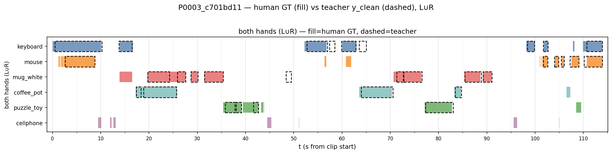
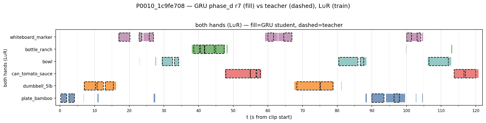
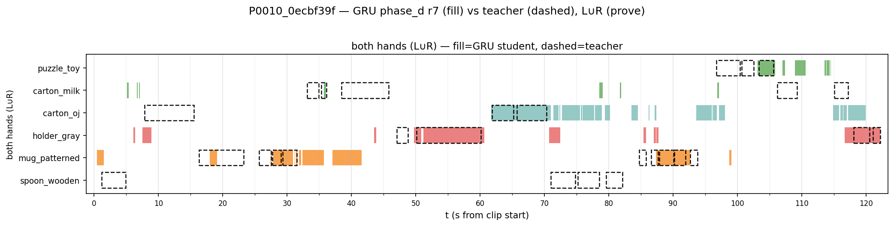
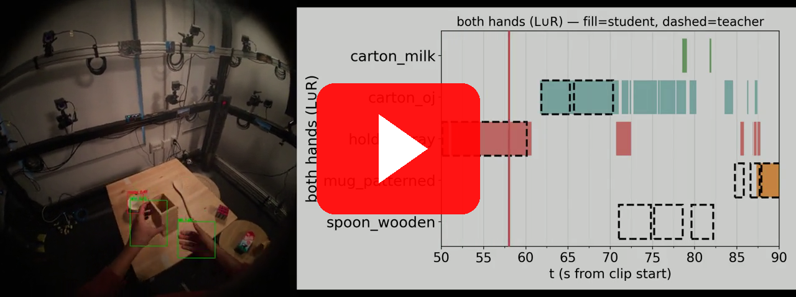

# EgoUse

Hand–object **interaction timelines** from egocentric video: *when is the wearer using each object?*

## Problem

Egocentric AR glasses need to know **what the wearer is using right now**, not after the fact.

The practical constraint is **live inference on a lightweight, low-power device**. Typical visual difficulties: Hands occlude objects, the camera moves with the head, and “using” something is a **time interval**, not a single box. The harder gap is deployment: similar egocentric HOI systems rely on **heavy deep models** and a **powerful machine for postprocessing**. That is fine for offline papers. It is not a glasses-class runtime.

EgoUse targets a **per-object swimlane** (ON/OFF over time) that a small on-device model can actually run.

## Approach

**Privileged labels in training, RGB only at deploy.** [HOT3D](https://github.com/facebookresearch/hot3d) Aria recordings include 3D object and hand poses that a wearable will not have in the wild. A **teacher** uses that 3D geometry (plus simple dwell / co-motion rules) to label interaction intervals. A **student** never sees 3D: off-the-shelf 2D hand and object detectors, pairwise spatial features, and a small temporal model.

The teacher is a label generator, not a runtime. On the one clip with human-annotated segments, it reaches **95% frame accuracy** vs those annotations.

*Human labels (filled) vs teacher (dashed)*

The student is what would run on-device. It is trained only from teacher labels — no ground-truth poses or boxes in its features. On held-out clips, **76% frame accuracy** vs the teacher. Once detections exist, the temporal model is **under a second** for a ~2-minute clip on CPU.

*Student (filled) vs teacher (dashed) — training clip*

*Student (filled) vs teacher (dashed) — held-out clip*

## Demo

**[Watch the 40-second demo on YouTube](https://youtu.be/bWZrYyKokh0)**

